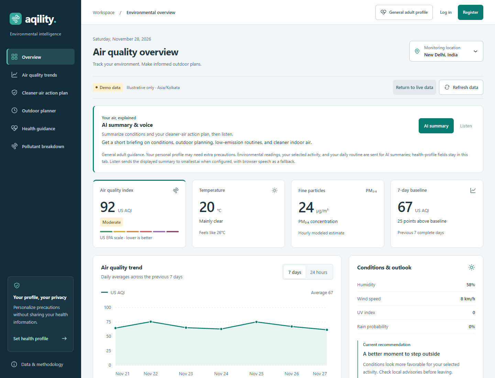
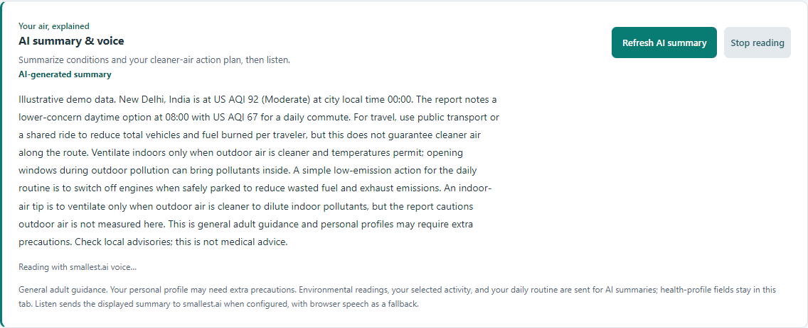
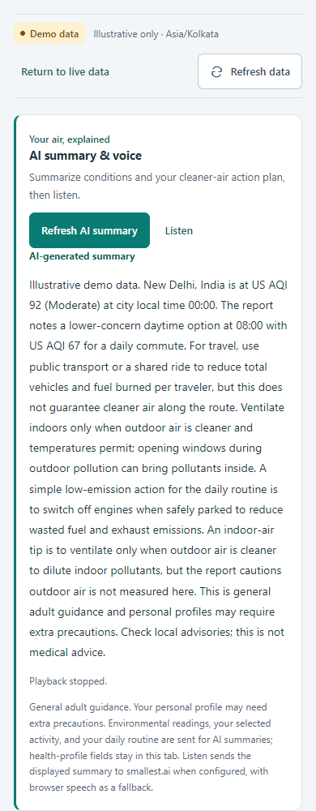
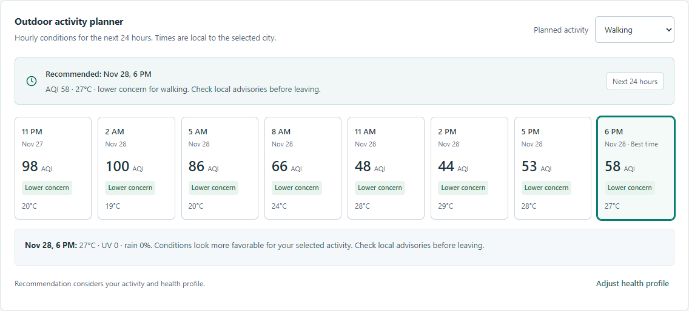
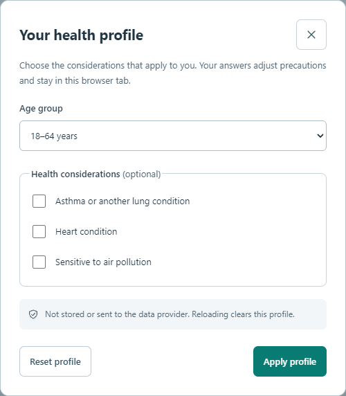
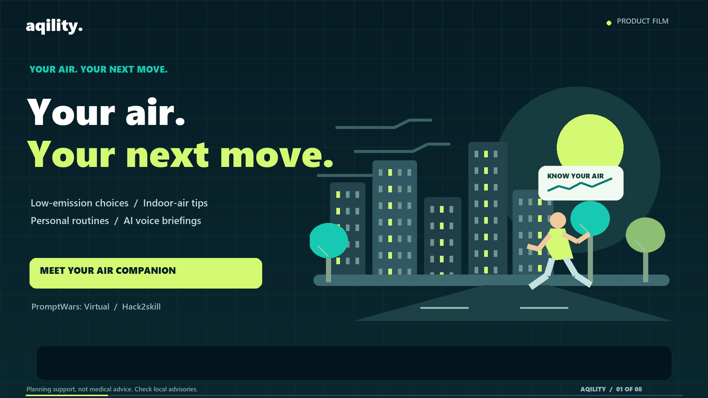

<div align="center">


# Aqility

**Know your air. Plan your day.**<br>
Air-quality insights, outdoor planning, AI summaries, and spoken briefings in one dashboard.

[](LICENSE)
[](https://nodejs.org/)
[](https://github.com/ayusht9/aqility/stargazers)
[](https://github.com/ayusht9/aqility/forks)
[](https://github.com/ayusht9/aqility/issues)
[](https://github.com/ayusht9/aqility/commits/dev/)
[](https://github.com/ayusht9/aqility)

[**ChatGPT-hosted preview**](https://aqility-air-companion.afloatsesame32.chatgpt.site) ·
[Watch the demo](https://raw.githubusercontent.com/ayusht9/aqility/dev/docs/media/aqility-demo.mp4) ·
[Quick start](#quick-start) ·
[Screenshots](#screenshots) ·
[Development guide](docs/DEVELOPMENT.md)



</div>

Aqility brings modeled US AQI and weather together with a 24-hour outdoor planner, optional personal precautions, and an AI-generated briefing you can read or listen to.

The ChatGPT-hosted link is an earlier published preview and may differ from `dev`. Run locally for the latest AI and voice integration. Server API keys are configured separately for each deployment.

## Features

| Feature | What it does |
| --- | --- |
| **Air quality and weather** | View US AQI, fine particles, temperature, humidity, wind, UV, and rain probability for a searched city or your device location. |
| **Trends and exports** | Compare seven-day daily and 24-hour hourly history, inspect exact values, and download labeled CSV data. |
| **Outdoor planner** | Compare the next 24 hours for walking, running, or commuting using pollution and weather thresholds. |
| **Personal precautions** | Adjust guidance with an optional age and health profile that stays in memory in the browser tab. |
| **AI summary** | Generate a briefing with OpenAI GPT-5 nano. A clearly labeled local summary works without an API key. |
| **Spoken briefings** | Listen with smallest.ai, replay cached audio, and stop anytime. Browser speech provides a fallback. |
| **Email OTP** | Supabase-backed registration and login using a numeric email code; delivery requires project email configuration. |
| **Accessible interface** | Responsive layouts, keyboard controls, visible focus, native dialogs, chart text alternatives, and reduced-motion support. |

## Screenshots

<table>
  <tr>
    <td width="65%"><br><sub><b>AI summary and voice</b> — generated from the environmental report.</sub></td>
    <td width="35%" rowspan="2"><br><sub><b>Mobile</b> — the same briefing on a smaller screen.</sub></td>
  </tr>
  <tr>
    <td><br><sub><b>Outdoor planner</b> — compare hours and change your activity.</sub></td>
  </tr>
</table>

<details>
<summary><b>Health profile and privacy</b></summary>



Health fields stay in memory in the browser tab. They are excluded from authentication, AI-summary, and voice requests, and are cleared on reload or sign-out.

</details>

<sub>Screenshots use illustrative environmental demo data. AI text and cloud speech are real provider responses. Regenerate with <code>npm run screenshots</code> while the app is running with configured providers; this uses API credits. No account or API-key settings are photographed.</sub>

## Demo video

[](https://raw.githubusercontent.com/ayusht9/aqility/dev/docs/media/aqility-demo.mp4)

**[Watch or download the video](docs/media/aqility-demo.mp4)** · [Download subtitles](docs/media/aqility-demo.srt)

A 47-second horizontal 1080p walkthrough with original illustrations, actual app interactions, live AI generation, smallest.ai narration, and highlighted captions. Environmental data is labeled as illustrative. Audio contains narration and an app voice excerpt, with no background music or hum. See [reproduction steps](docs/DEVELOPMENT.md#demo-video).

## Quick start

Requires **Node.js 22.12 or newer** and npm. The public dashboard and local summaries work without API keys.

```sh
git clone https://github.com/ayusht9/aqility.git
cd aqility
git switch dev
npm ci
npm start
```

Open **http://localhost:5173**. Use **Explore demo** for labeled sample data, or search a city for modeled readings.

### Enable AI and cloud voice

Copy `.env.example` to `.env`, then fill in your own values locally:

```env
OPENAI_API_KEY=
OPENAI_SUMMARY_MODEL=gpt-5-nano
SMALLEST_API_KEY=
SMALLEST_VOICE_ID=meher
```

Restart `npm start`. Choose **AI summary** at the top of the dashboard, then **Listen**. Keys stay on the Node server; `.env` is ignored by Git. Do not paste keys into browser files, screenshots, issues, or pull requests.

| Setting | Purpose |
| --- | --- |
| `OPENAI_API_KEY` | Direct OpenAI summaries; takes priority over gateway credentials. |
| `OPENAI_SUMMARY_MODEL` | Summary model; defaults to `gpt-5-nano`. |
| `SMALLEST_API_KEY` | smallest.ai Lightning v3.1 Pro speech generation. |
| `SMALLEST_VOICE_ID` | Voice selection; defaults to `meher`. |
| `AI_GATEWAY_API_KEY` | Optional alternative to a direct OpenAI key. |
| `AI_SUMMARY_MODEL` | Gateway model; defaults to `google/gemini-3.8-flash`. |
| `PORT` | Local server port; defaults to `5173`. |

Requests use provider credits. Summary requests include only the city, selected activity, and environmental readings. Voice requests contain the displayed summary. Provider errors fall back to local summaries and browser speech where available.

For email login, configure the Supabase site URL, numeric-code email templates, and SMTP. See [email OTP setup](docs/DEVELOPMENT.md#email-otp-authentication). Real inbox delivery has not yet been verified.

## Tech stack

| Layer | Technology |
| --- | --- |
| Interface | HTML, CSS, vanilla JavaScript ES modules, responsive SVG charts |
| Server | Node.js HTTP server with bounded JSON endpoints |
| Environmental data | Open-Meteo APIs and CAMS modeled estimates |
| AI summaries | Vercel AI SDK with direct OpenAI GPT-5 nano or optional AI Gateway |
| Voice | smallest.ai Lightning v3.1 Pro, HTML audio, browser speech |
| Authentication | Supabase Auth email OTP and bundled browser SDK |
| Verification | Node test runner, Playwright, axe-core |
| Demo production | Playwright, FFmpeg, Pillow, smallest.ai narration and caption alignment |

## Development and checks

### Deploy on Vercel

Import this repository into Vercel with the **Other** framework preset. The included `vercel.json` builds `dist/` and routes `/api/summary` and `/api/voice` to a Node.js function in Mumbai. Use Node.js 24 for the deployment runtime.

Set `OPENAI_API_KEY` and `SMALLEST_API_KEY` as **sensitive production environment variables** in the Vercel project, with optional `OPENAI_SUMMARY_MODEL=gpt-5-nano` and `SMALLEST_VOICE_ID=meher`. Do not upload `.env`. The production branch is `main`; changes on `dev` remain development work until a tested release. Preview deployments without provider secrets use the local-summary and browser-speech fallbacks.

The voice server caps audio at 4 MiB to stay below Vercel's response limit. Request counters are per function instance, rather than a global account quota. Monitor your provider usage for public deployments. Configure the Vercel origin in Supabase when completing email login setup.

### Run checks

```sh
npm test                # Unit and HTTP boundary checks
npm run build           # Bundle the Supabase browser SDK
npm run test:browser    # Dashboard interactions and accessibility
npm run test:auth       # Email OTP flows with mocked provider responses
npm run test:summary    # Summary and browser speech flows
npm run test:voice      # Cloud playback behavior with mocked audio
```

Keep the app running for browser checks. The summary browser suite expects a server with AI credentials unset for its local-fallback check: run `node server.js` in a clean environment on a separate `PORT` and point `BASE_URL` at it. Browser scripts use installed Chrome by default; set `BROWSER_CHANNEL=chromium` after installing Playwright Chromium to use it instead. Automated accessibility checks complement manual testing and do not certify conformance.

Live GPT-5 nano generation, smallest.ai WAV delivery, audio decoding, and Stop playback have also been verified locally with configured credentials. Automated provider tests use simulated responses.

See the [development guide](docs/DEVELOPMENT.md) for authentication, API behavior, accessibility coverage, and video production.

## Contributing

Start temporary `feature/*` or `bugfix/*` branches from the latest `dev`. Validate changes, squash merge each completed feature or fix into `dev`, then delete the temporary branch. `main` is the stable production branch and receives tested releases or urgent hotfixes. Use conventional commits and keep credentials out of commits.

[Report a bug or suggest an improvement](https://github.com/ayusht9/aqility/issues) with steps to reproduce it. For changes involving AI, describe local fallback and configured-provider behavior.

## Scope and sources

Aqility is a hackathon prototype for environmental planning, not a clinical risk model. Forecasts and history are modeled estimates, not measurements at your exact location. The planner uses explainable heuristics; AI summaries rephrase its report and can make mistakes. Follow local advisories and your clinician's care plan.

- [Open-Meteo air-quality API](https://open-meteo.com/en/docs/air-quality-api) and [weather API](https://open-meteo.com/en/docs).
- [Copernicus Atmosphere Monitoring Service](https://atmosphere.copernicus.eu/) modeled air-quality data.
- [AirNow AQI basics](https://www.airnow.gov/aqi/aqi-basics/) and [particle-pollution guidance](https://www.airnow.gov/sites/default/files/2023-03/air-quality-guide-for-particle-pollution_0.pdf).

## License

[MIT](LICENSE) © 2026 Ayush. Dependencies, provider services, and environmental datasets retain their own licenses and terms. This repository's license does not grant rights to third-party data or remove provider usage restrictions.
